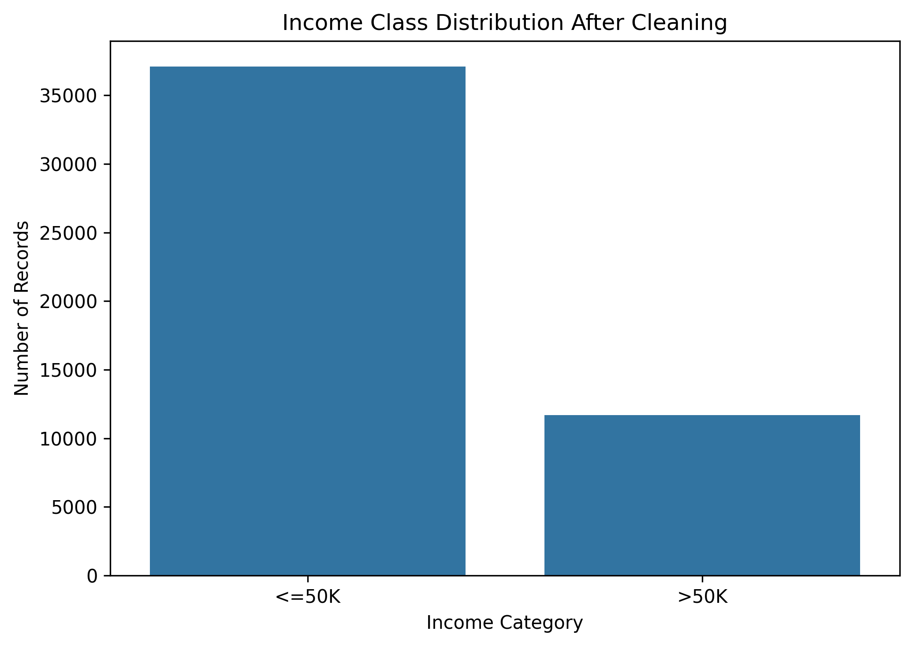
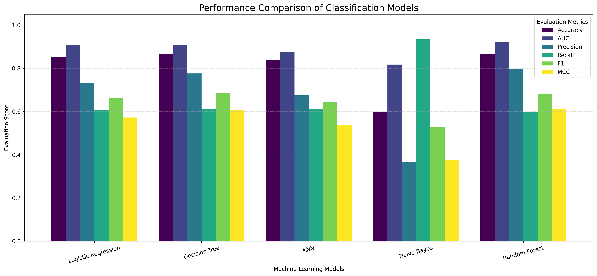
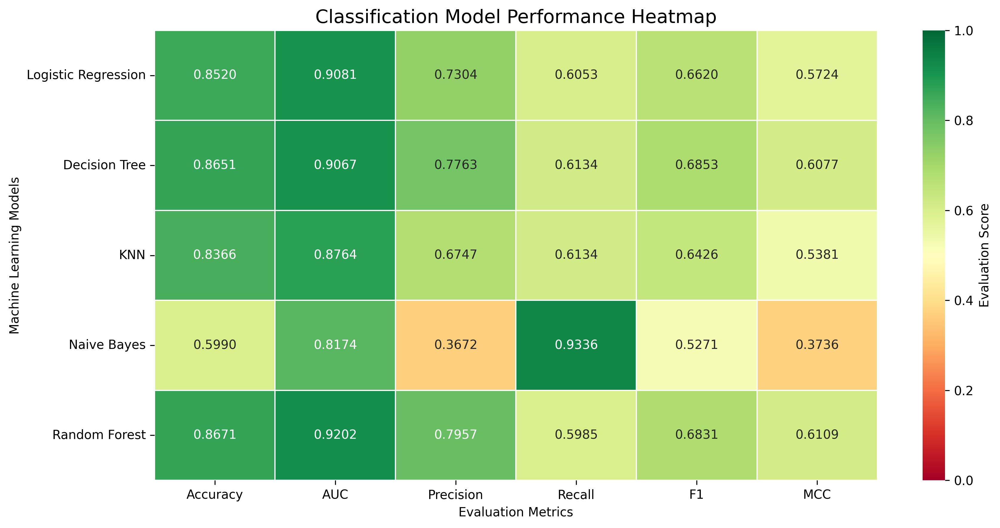
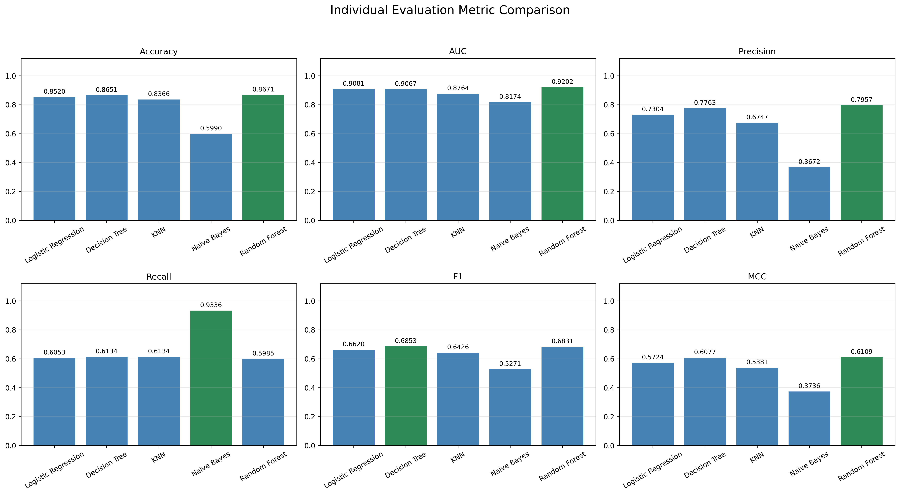
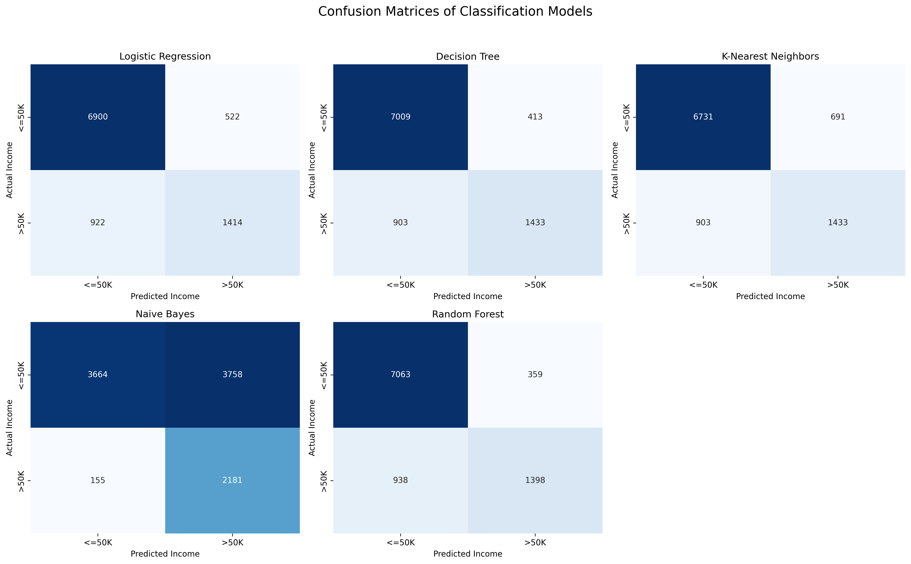
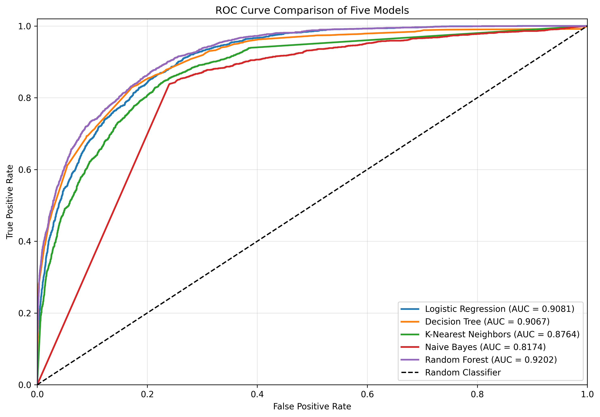

# Machine Learning Assignment 2

BITS ID: 2026CT05153
Programme: M.Tech AIML Course: Machine Learning
Assignment: Classification Model Development and Comparative Evaluation

## A. Problem statement

The objective is to predict whether an individual's annual income exceeds $50,000 using demographic and employment-related attributes, and compare five supervised classification algorithms on a common held-out test set.

## B. Dataset description

Source: [UCI Adult Census Income dataset](https://archive.ics.uci.edu/dataset/2/adult).

The dataset was selected because it satisfies the minimum instance and feature requirements and provides a practical binary classification problem involving mixed feature types, missing values and class imbalance.

| Property | Value |
|---|---:|
| Original records | 48,842 |
| Original input features | 14 |
| Numerical features | 6 |
| Categorical features | 8 |
| Cleaned records | 48,790 |
| Training records | 39,032 |
| Testing records | 9,758 |
| Transformed features | 105 |

**Numerical features:** age, fnlwgt, education-num, capital-gain, capital-loss, hours-per-week.

**Categorical features:** workclass, education, marital-status, occupation, relationship, race, sex, native-country.

**Target:** `income`, encoded as 0 for income <=50K and 1 for income >50K.

### Exploratory data analysis

The original target contained labels with and without trailing periods. After standardization, the two classes contained 37,155 and 11,687 records respectively. After duplicate removal, the class proportions were approximately 76.06% and 23.94%, indicating class imbalance.

| Feature | Missing cells before duplicate removal |
|---|---:|
| workclass | 2,799 |
| occupation | 2,809 |
| native-country | 857 |
| Total | 6,465 |



### Data preprocessing

1. Strip whitespace and remove trailing periods from target labels.
2. Replace question-mark missing-value markers with NaN.
3. Remove 52 duplicate records after standardization (29 were detected in the initial raw-data check).
4. Separate the 14 input features and binary target.
5. Perform an 80:20 stratified train-test split with random seed 42. Both subsets preserve the cleaned class proportions to two decimal places.
6. Use median imputation and StandardScaler for numerical features.
7. Use most-frequent imputation and one-hot encoding for categorical features, ignoring unseen categories during transformation.
8. Fit the preprocessing transformer only on training data and transform the test data without refitting. Both processed matrices contain 105 features and zero missing values.

No resampling or class weighting was applied. Class imbalance was examined using class proportions, a majority-class baseline and multiple evaluation metrics.

## C. GitHub repository link

**Replace with your actual repository URL:** https://github.com/YOUR_USERNAME/Adult-Income-Classification-ML

### Repository structure

```text
Adult-Income-Classification-ML/
├── README.md
├── requirements.txt
├── test_data.csv
├── model_comparison.csv
├── model/
│   ├── ML_Assignment_2_Adult_Income.ipynb
│   ├── logistic_regression.joblib
│   ├── decision_tree.joblib
│   ├── knn.joblib
│   ├── naive_bayes.joblib
│   └── random_forest.joblib
└── visualizations/
    ├── income_distribution.png
    ├── model_comparison.png
    ├── performance_heatmap.png
    ├── confusion_matrices.png
    ├── roc_curves.png
    └── individual_metrics.png
```

### Execution instructions

1. Clone or download the repository.
2. Install dependencies with `pip install -r requirements.txt`.
3. Open `model/ML_Assignment_2_Adult_Income.ipynb` in Google Colab or Jupyter.
4. Run the data-loading, preprocessing, training, evaluation and visualization cells in order. Internet access is required to retrieve the UCI dataset. Colab-specific packaging cells may require adaptation in other environments.
5. Review the evaluation table and generated graphs.

The saved joblib files contain the fitted preprocessor and classifier. The test CSV contains the original 14 input features and encoded target for the 9,758 held-out records. All five saved pipelines were reloaded and verified to reproduce the original predictions in Colab. Only load trusted joblib files using compatible library versions.

## D. Models used

### Model configurations

| Model | Configuration |
|---|---|
| Logistic Regression | max_iter=1000, random_state=42, default lbfgs solver |
| Decision Tree | criterion=gini, max_depth=10, min_samples_split=10, random_state=42 |
| K-Nearest Neighbors | n_neighbors=7, weights=distance, metric=minkowski, p=2, n_jobs=-1 |
| Gaussian Naive Bayes | var_smoothing=1e-9 |
| Random Forest (Ensemble) | n_estimators=100, max_depth=15, min_samples_split=5, random_state=42, n_jobs=-1 |

These are fixed experimental configurations, not hyperparameters optimized through cross-validation.

### Evaluation metrics comparison

All models were evaluated on the same test set. Precision, recall and F1 refer to positive class 1 (>50K). ROC-AUC uses positive-class predicted probabilities. MCC denotes Matthews Correlation Coefficient.

| ML Model Name | Accuracy | AUC | Precision | Recall | F1 | MCC |
|---|---:|---:|---:|---:|---:|---:|
| Logistic Regression | 0.8520 | 0.9081 | 0.7304 | 0.6053 | 0.6620 | 0.5724 |
| Decision Tree | 0.8651 | 0.9067 | 0.7763 | 0.6134 | **0.6853** | 0.6077 |
| KNN | 0.8366 | 0.8764 | 0.6747 | 0.6134 | 0.6426 | 0.5381 |
| Naive Bayes | 0.5990 | 0.8174 | 0.3672 | **0.9336** | 0.5271 | 0.3736 |
| Random Forest (Ensemble) | **0.8671** | **0.9202** | **0.7957** | 0.5985 | 0.6831 | **0.6109** |

### Graphical representation

#### Comparison of all six metrics



#### Performance heatmap



#### Individual metric comparison



#### Confusion matrices



#### ROC curves



### Baseline comparison

The majority-class DummyClassifier achieved accuracy of 0.7606.

| Model | Accuracy improvement (percentage points) |
|---|---:|
| Logistic Regression | +9.14 |
| Decision Tree | +10.45 |
| KNN | +7.60 |
| Naive Bayes | -16.16 |
| Random Forest | +10.65 |

### Model performance observations

| ML Model Name | Observation about model performance |
|---|---|
| Logistic Regression | Accuracy of 85.20% and AUC of 0.9081 provide a competitive linear baseline. Recall of 0.6053 indicates that many positive cases remain undetected. |
| Decision Tree | Accuracy of 86.51% and the highest F1 of 0.6853 indicate a strong balance between precision and recall. Depth restriction was used to limit model complexity. |
| KNN | Accuracy of 83.66% exceeds the majority baseline. Distance-based classification in the 105-dimensional feature space may contribute to its weaker performance relative to the tree models. |
| Naive Bayes | Highest recall (0.9336), but low precision (0.3672) and 3,758 false positives. Its Gaussian and conditional independence assumptions may contribute to this behavior. Accuracy is below the majority baseline. |
| Random Forest (Ensemble) | Highest accuracy, AUC, precision and MCC. It produced only 359 false positives, but missed 938 positive cases, indicating a precision-recall trade-off. |
| Overall winner | Random Forest, based on leading four of six metrics, including AUC of 0.9202 and MCC of 0.6109. Decision Tree is a close alternative and has a slightly higher F1 score. |

### Conclusion and limitations

Random Forest performed best overall under the selected configurations on this held-out test set. Its accuracy exceeds the majority-class baseline by 10.65 percentage points. The small difference from Decision Tree does not establish statistical superiority. Further work could examine cross-validation, training-only hyperparameter tuning and threshold selection. The dataset contains demographic attributes such as race and sex; subgroup fairness was not evaluated, and these results do not establish suitability for real-world employment or financial decisions.
